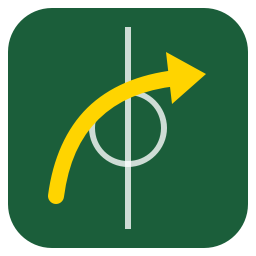

# FC27 Tactical Studio

A Windows desktop workstation for analysing EA SPORTS FC 27 match recordings: frame-exact
playback, incident bookmarks, tactical drawings and a live telestrator for presenting.



## Features (Milestone 1)

**Review workspace**
- Frame-exact playback of MP4/MKV/MOV/AVI/WebM (H.264, HEVC, VP9, AV1… via FFmpeg), including B-frame streams
- J/K/L shuttle, Space, frame stepping (←/→), big steps (Shift+←/→), go-to time/frame (Ctrl+J)
- Speeds 0.1× – 4×, reverse play, A/B loop (`[`, `]`, Ctrl+L)
- Zoomable timeline with hover thumbnails, bookmark markers, loop region and drawing ranges
- Incident bookmarks: categories (custom colours), tags, players, importance, notes, optional clip end,
  thumbnails, search, category/player filters and sorting

**Tactics workspace**
- 10 drawing tools: arrow, curved arrow, dashed run, line, freehand, circle, rectangle, zone, text, spotlight
- Select, move, resize, rotate, edit points; Shift constrains angles/shapes
- Colour, thickness, opacity, fill, text size, rotation, visible frame range
- Layer order, grouping, hide/show, copy/paste/duplicate, multi-select, rubber-band selection
- Full undo/redo for every edit

**Present workspace**
- Telestrator: draw live over the video; temporary drawings clear on play (or keep them in the project)
- Presentation mode (F5): full-screen video with transport only; incident playlist

**Projects**
- `.fc27studio` project files (JSON), atomic saves with `.bak` backup and automatic fallback if a file is damaged
- Autosave + crash recovery, relinking of moved or missing videos (relative-path and same-folder search)
- Export frames as PNG/JPG at full video resolution (with or without drawings), copy to clipboard,
  batch-export bookmark images, export the bookmark list to CSV
- Configurable keyboard shortcuts with conflict detection; F1 shortcut reference card

## Getting the Windows app

**Option A — download a build (no Python needed).** Every push to `main` builds the app on a Windows
runner in GitHub Actions. Open the repository's **Actions** tab → latest **Windows build** run →
download **FC27TacticalStudio-windows-x64** → unzip → run `FC27TacticalStudio.exe`.

**Option B — build it yourself.** Install 64-bit Python 3.12 from python.org, then double-click
`scripts\build_windows.bat` (or run it from a terminal). The result is
`dist\FC27TacticalStudio\FC27TacticalStudio.exe`. See [docs/BUILD.md](docs/BUILD.md).

## Running from source

```bash
python -m venv .venv
.venv\Scripts\activate          # macOS/Linux: source .venv/bin/activate
pip install -r requirements-dev.txt
python run.py                    # optionally: python run.py path\to\match.mp4
python -m pytest -q tests        # 49 tests
```

## Documentation

- [User guide](docs/USER_GUIDE.md)
- [Architecture](docs/ARCHITECTURE.md)
- [Building and packaging](docs/BUILD.md)
- [Licensing and third-party components](docs/LICENSING.md)
- [Roadmap](docs/ROADMAP.md)

*Not affiliated with or endorsed by Electronic Arts. "EA SPORTS FC" is a trademark of Electronic Arts Inc.*
